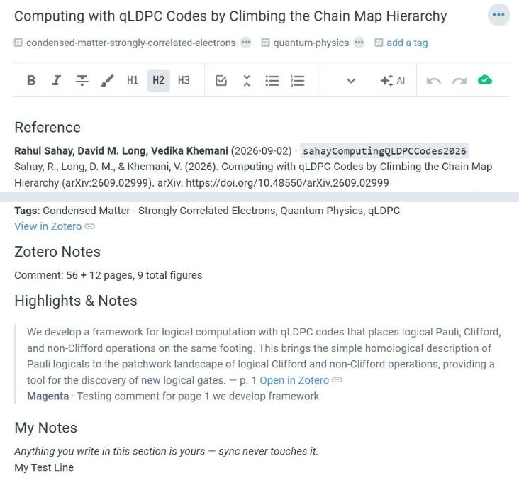
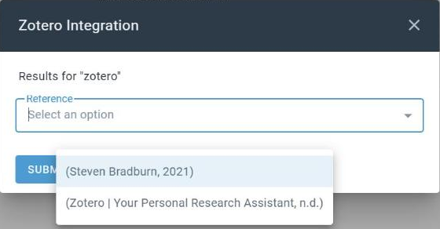
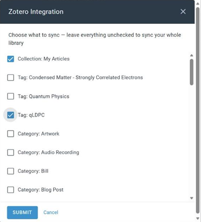

# Zotero Integration

An [Amplenote](https://www.amplenote.com) plugin that brings your
[Zotero](https://www.zotero.org) library into your notes. Search it and drop a citation
in at the cursor, in any citation style; sync each Zotero item into its own note, with
its reference, abstract, tags, your Zotero notes, and every highlight you made in
Zotero's PDF reader; and keep those notes current with one click, without ever touching
what you wrote in them.

It works with your **online** Zotero library, so Zotero desktop doesn't need to be
running.

Install it from
**[its plugin page](https://www.amplenote.com/plugins/2vv8Fj5VhKuuLEGmnVv3K4mA)**.



## What it does

- **Cites as you write** — type `/zotero` where the citation should go, search by title,
  author or year, pick the reference, and it lands at the cursor. In any Zotero citation
  style (APA, Chicago, IEEE, MLA, …), as a full bibliography entry, as a Pandoc, LaTeX or
  BibLaTeX cite key, or as a complete BibTeX entry. Cite keys use Better BibTeX's
  Citation Key when you have one, and the BibTeX entry always uses the same key.
- **Syncs your library into notes** — one note per Zotero item, named after it and
  tagged with its Zotero tags, in four sections: **Reference** (formatted reference,
  abstract, DOI link, links back to Zotero), **Zotero Notes**, **Highlights & Notes**,
  and **My Notes**. After the first run, sync fetches only what changed.
- **Never overwrites your writing** — a re-sync rewrites the three Zotero sections and
  nothing else. My Notes, and any section you add yourself, are left alone.
- **Imports every highlight** — each highlight, underline and note from Zotero's PDF
  reader, with its color, page and comment, and a link that opens the PDF at that page
  in Zotero desktop.
- **Imports one item on demand** — **Import item** gives a single reference its note
  without syncing anything else, then opens it.
- **Syncs only what you choose** — tick collections, tags and item types, or leave
  everything unticked for the whole library.
- **Reads group libraries** — switch from My Library to any group your key can read.
- **Lets you shape the notes** — optional templates for the Reference section and for
  each highlight, with fields like `{{authors}}`, `{{citeKey}}`, `{{doi}}` and `{{page}}`.
- **Works on a phone** — tested in the Android app; see
  [below](#known-limitations-on-a-phone) for what differs.

| Picking a reference | Choosing what to sync |
|---|---|
|  |  |

## Setting up

1. Create a Zotero API key at **zotero.org/settings/keys → Create new private key**. Tick
   **Allow library access** and **Allow notes access**, and leave write access off: the
   plugin only reads from Zotero, so a read-only key is the safe choice. To use a group
   library, also give the key read access to that group.
2. Run any Zotero action, such as **Zotero: Test connection**. The first time, it asks
   for your key, checks it with Zotero and saves it.

Everything lives under `/zotero` in a note. On a phone, `/zotero` lists only **Insert
citation**; the other actions are under the search icon.

The plugin's settings are rows in its plugin note's metadata table. Only the key is
required; the rest are optional and blank by default:

| Setting | What it holds |
|---|---|
| `Zotero API key` | Your Zotero key (saved for you on first run) |
| `Zotero citation style` | Any Zotero style id — `apa`, `ieee`, `modern-language-association`, … Blank means Chicago |
| `Zotero citation format` | `formatted`, `bibliography`, `pandoc`, `latex`, `biblatex` or `bibtex`, to skip the format question |
| `Zotero sync filter` | What to sync — written by **Configure sync** |
| `Zotero library` | Which library to read — written by **Choose library**. Blank means My Library |
| `Zotero reference template`, `Zotero highlight template` | Optional layouts; see [`docs/development.md`](docs/development.md#layout-templates--live-verified-2026-09-21) |

The full user guide, as it appears in the plugin's own instructions, is in
[`docs/plugin-instructions.md`](docs/plugin-instructions.md).

## The Zotero Sync note

A plugin gets no database of its own, so the plugin keeps its bookkeeping — which Zotero
item belongs to which note, and how far the last sync got — in a note called
**Zotero Sync**, as a block of JSON labelled *"do not edit by hand"*.

That label is literal. Editing it can make the next sync redo everything or skip items.
Deleting the whole note is safe but costly: the next sync starts over and creates a
second note for every item.

Two things a re-sync deliberately leaves alone: **tags**, which are set once when a note
is created, and **deleted items** — deleting an item in Zotero doesn't delete its note,
which just stops being updated.

## PDFs

The plugin links to your PDFs; it doesn't copy them into Amplenote. Amplenote doesn't
accept PDFs as plugin attachments, and Zotero's file storage can't be read from inside a
plugin — both measured, along with six ways of viewing a PDF in the note, in
[`docs/zotero-findings.md`](docs/zotero-findings.md). Your highlights and notes come
across in full regardless: they're stored as text, separately from the file.

## Known limitations on a phone

Everything tested in the Android app works there except two things (Import item and
Choose library, the newest actions, haven't been run on a phone yet):

- **Search citation** can't tell which note you have open when it's run from the phone's
  search, so it stops and says so. Use **Insert citation** from `/zotero` instead, which
  writes at the cursor.
- **Open in Zotero** links on highlights do nothing — the Zotero Android app doesn't
  accept them. **View in Zotero**, which opens the item on zotero.org, works everywhere.

The full run, action by action, is in [`docs/mobile-check.md`](docs/mobile-check.md).

## Development

```bash
npm install
npm run build
npm test
```

[`docs/development.md`](docs/development.md) covers the rest: why there's a build step,
the repo layout, the testing approach, and how each feature was verified in the live app.

### Getting your own build into Amplenote

To *use* the plugin, install it from
[its plugin page](https://www.amplenote.com/plugins/2vv8Fj5VhKuuLEGmnVv3K4mA) — there is
nothing here you need. This section is for running a build of your own: a fork, a local
change, or a fix in progress.

**Sync from GitHub.** Install the
[Plugin Builder](https://github.com/alloy-org/plugin-builder) plugin, then in your
plugin's note add this line as plain text, **above** an H1 heading named exactly
`Code block`:

```
entry: tashreefshareef/amplenote-zotero-integration/dist/plugin.js
```

Run **Plugin Builder: Refresh** and it pulls that build straight from GitHub. This is
why `dist/` is committed: `dist/plugin.js` on `main` *is* the sync endpoint. If a refresh
doesn't pick up a change you just pushed, GitHub's raw content can lag a few minutes;
wait and retry.

**Or paste by hand.** Copy the whole of **`dist/plugin-paste.js`** (not `plugin.js` —
that one omits the final `return plugin` Plugin Builder adds for you) into the note's
code block. Click **inside** the code block first, press Ctrl+A, and confirm the
selection covers only the block before pasting.

## Contributing

[`docs/api-notes.md`](docs/api-notes.md) records confirmed Amplenote API behaviour and
platform quirks, [`docs/zotero-findings.md`](docs/zotero-findings.md) the Zotero side, and
[`docs/bugs-found.md`](docs/bugs-found.md) what went wrong along the way.

1. Edit `src/`, not `dist/`.
2. Add a test for anything that touches note data.
3. Run `npm test` and `npm run build` before committing, and commit the rebuilt `dist/`
   alongside your source change.
4. Check the change in the live Amplenote app — a passing test against the mock isn't
   proof the platform behaves that way.

Then open a pull request. If you'd rather just report something — a bug, or a Zotero
setup the plugin mishandles — an issue is just as welcome.

## License

MIT — see [LICENSE](LICENSE).
